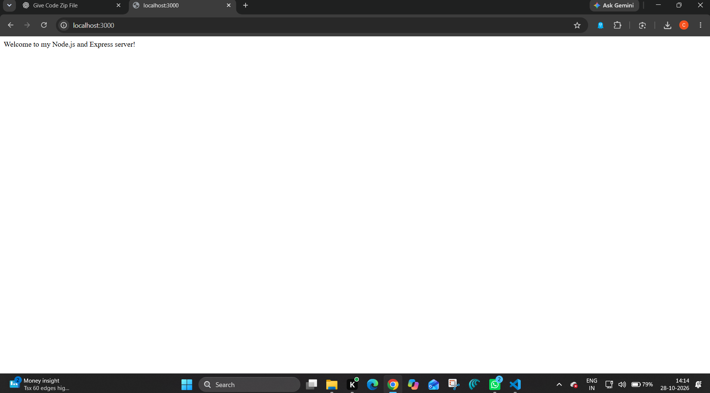
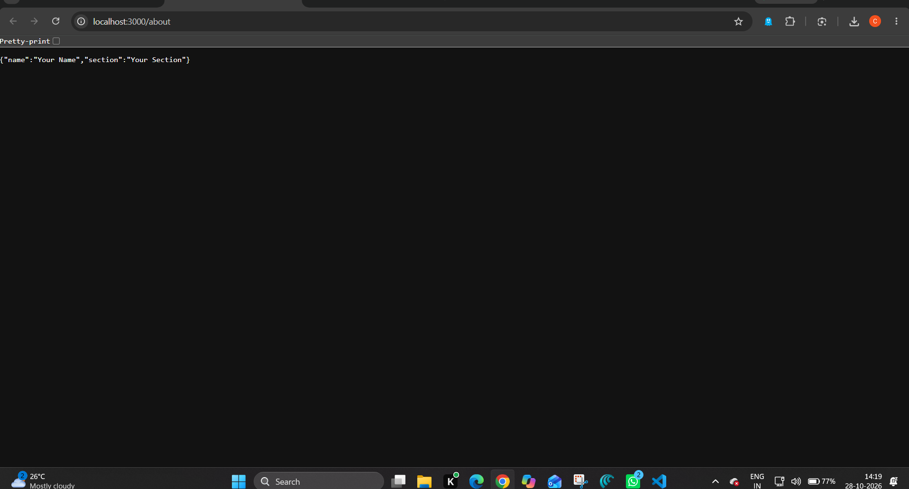
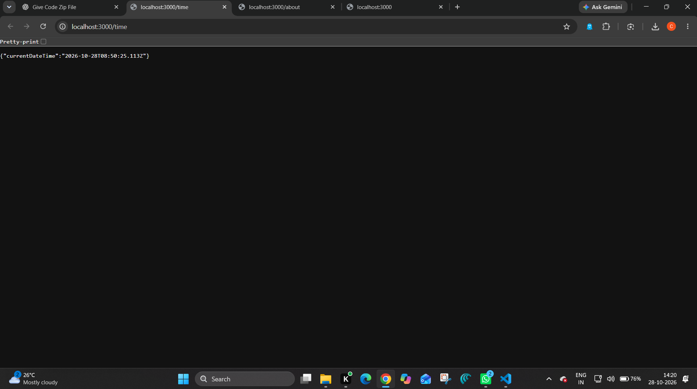

# Lab 1: Node.js and Express server

**Name:** G.Chandu  
**Registration number:** 252U1R9037  
**Section:** CSE-GEN-AI-2A-304  

## Live link
https://backend-lab-reports.onrender.com/

## Requirements
- Node.js (LTS recommended)
- npm (included with Node.js)

## Install and run
Open a terminal in this folder and run:

```bash
npm install
npm start
```

The server runs at `http://localhost:3000` by default. The hosting platform's `PORT` environment variable is used when available.

## Endpoints

| Method | Path | Description | Expected status |
|---|---|---|---|
| GET | `/` | Welcome text | 200 |
| GET | `/about` | JSON containing name and section | 200 |
| GET | `/time` | Current date and time in ISO format | 200 |
| GET | Any unknown path, e.g. `/wrong` | JSON 404 error | 404 |

## Plain Node.js HTTP server
To run the server built with the built-in `http` module instead of Express:

```bash
node http-server.js
```

Open `http://localhost:3000`. This uses the same port, so stop the Express server first with `Ctrl+C`.

## Explain package.json
- `name`: project package name.
- `version`: current project version.
- `description`: short project summary.
- `main`: main JavaScript file.
- `scripts`: shortcuts for commands such as `npm start`.
- `keywords`: searchable project tags.
- `author`: project author; replace with your name.
- `license`: license identifier.
- `dependencies`: packages required by the app, including Express.

## package.json vs node_modules
`package.json` records project metadata, scripts, and dependency requirements. `node_modules` contains the installed package code. Do not commit `node_modules`; `.gitignore` excludes it.

## What does app.listen do?
`app.listen()` starts the Express server and makes it listen for requests on the selected port.

## What are request and response?
`req` (request) contains details sent by the client, such as the URL and HTTP method. `res` (response) is used by the server to send back content and a status code.

## Screenshots
Create a `screenshots/` folder and add screenshots of `/`, `/about`, `/time`, and an unknown route. Then add them here, for example:

```md




```

## Notes
- Take screenshots of the working routes.
- Do not commit `.env` or `node_modules`.
- Write and understand the code yourself, as the lab may include a viva.
