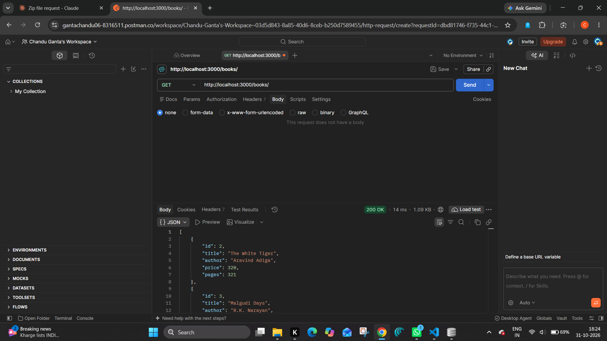
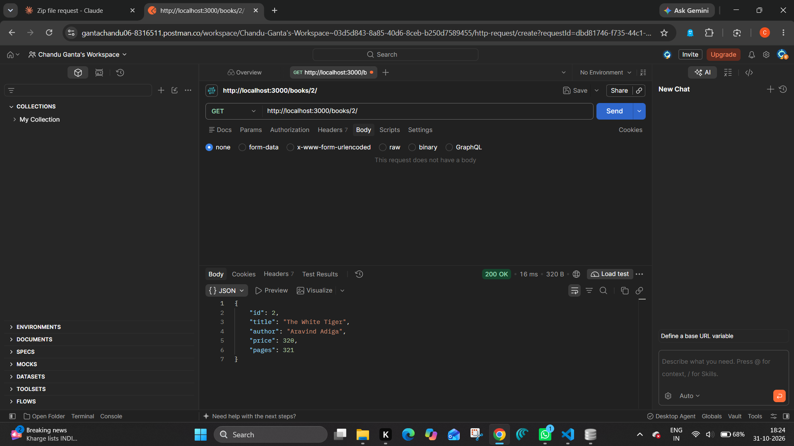
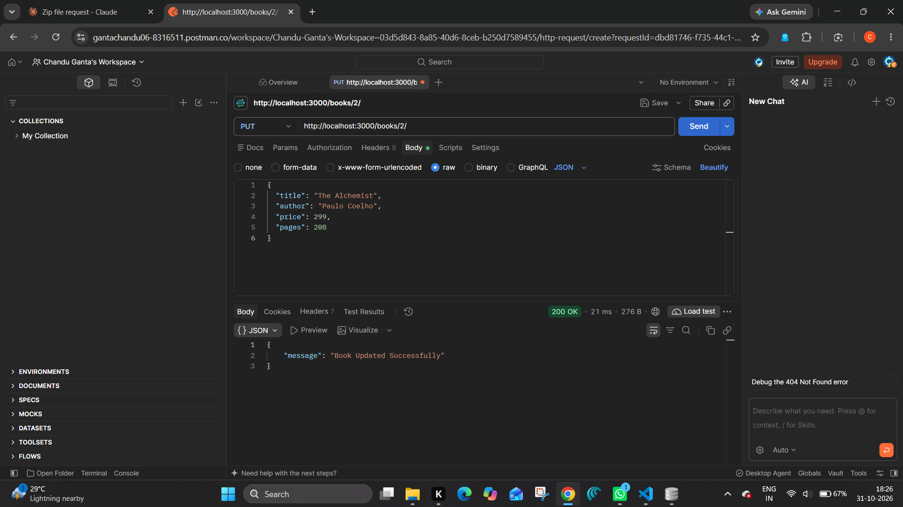
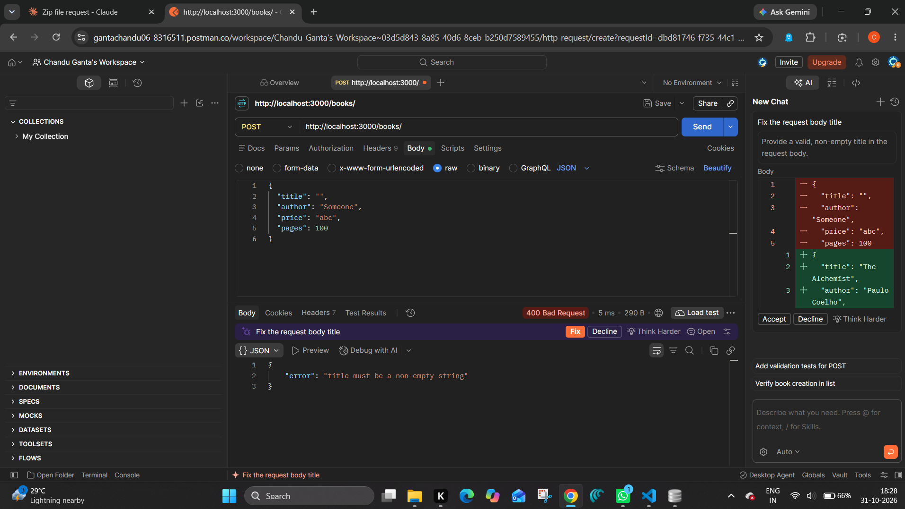
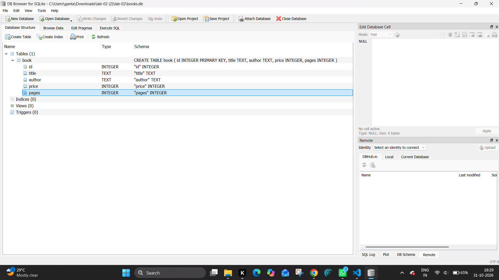

# Lab 2: SQLite database and CRUD routes

- **Name:** M. Chandu
- **Registration Number:** YOUR_REGISTRATION_NUMBER
- **Section:** YOUR_SECTION
- **Course:** Backend Development Fundamentals
- **Lab Number:** 02

## Live Link

**Deployment URL:** YOUR_LIVE_URL_HERE

*(If the project cannot be deployed, replace this line with the reason and rely on the Postman screenshots below.)*

## Objective

Connect an Express server to a SQLite database and expose CRUD operations (Create, Read, Update, Delete) over HTTP.

## Technologies Used

Node.js, Express.js, SQLite (`sqlite` + `sqlite3` packages), nodemon, Postman, Visual Studio Code

## Project Structure

```
lab-02/
├── screenshots/
├── app.js            # Express server, database connection and all routes
├── books.db          # SQLite database file (table: book, 10 rows)
├── seed.sql          # SQL used to create the table and insert the rows
├── package.json
├── .env.example
├── .gitignore
└── README.md
```

## How to Run

**Prerequisites:** Node.js and npm installed. (Optional: the SQLite CLI, to inspect `books.db`.)

```
cd lab-02
npm install
npm run dev      # development: nodemon restarts the server on every change
npm start        # plain start: node app.js
```

The server runs at `http://localhost:3000/`.

**Environment variables:** none are required. `PORT` is optional (default `3000`); see `.env.example`. Never commit a real `.env` file.

### Create the database again (optional)

```
sqlite3 books.db < seed.sql
```

To inspect the data:

```
sqlite3 books.db
.headers on
.mode column
SELECT * FROM book;
```

## Endpoints

| Method | Path              | Description                  | Success     | Error statuses |
| ------ | ----------------- | ---------------------------- | ----------- | -------------- |
| GET    | `/books/`         | Returns all books            | 200 OK      | 500            |
| GET    | `/books/:bookId/` | Returns one book by id       | 200 OK      | 400, 404, 500  |
| POST   | `/books/`         | Adds a new book (JSON body)  | 201 Created | 400, 500       |
| PUT    | `/books/:bookId/` | Updates all fields of a book | 200 OK      | 400, 404, 500  |
| DELETE | `/books/:bookId/` | Deletes a book               | 200 OK      | 400, 404, 500  |

**Request body for POST and PUT:**

```json
{
  "title": "Sample Book",
  "author": "Sample Author",
  "price": 300,
  "pages": 200
}
```

- `400 Bad Request`: invalid id, missing or invalid fields, or invalid JSON.
- `404 Not Found`: no book with that id, or an unknown route.
- Every query that uses user input is parameterised with `?` placeholders.

## Screenshots

### GET all books


### GET one book


### POST add a book (201)


### PUT update a book


### DELETE remove a book


### Invalid input (400)


### SQLite database view


## Viva Questions

### 1. Why `await` the database call?

Database calls take time and return a Promise. `await` pauses the function until the result is ready, so we work with real data and not an unfinished Promise. It also makes the server wait for the connection to open before it starts listening.

### 2. What is SQL injection and how do placeholders prevent it?

SQL injection is when an attacker types SQL code into an input (for example `1 OR 1=1`) and it becomes part of the query. With `?` placeholders the SQL text and the values are sent separately, so the input is always treated as data and never as SQL code.

### 3. When is PUT used instead of POST?

POST creates a new resource and the server chooses the id. PUT updates (replaces) an existing resource at a known URL such as `/books/3/`.

## Notes: Problems Faced and Solutions

- Write your own notes here: an error you hit while testing in Postman or deploying, and how you fixed it.
- Free hosting plans may reset the file system on restart, so changes made through POST, PUT and DELETE on the live link can disappear after a redeploy. The local `books.db` keeps its changes.
