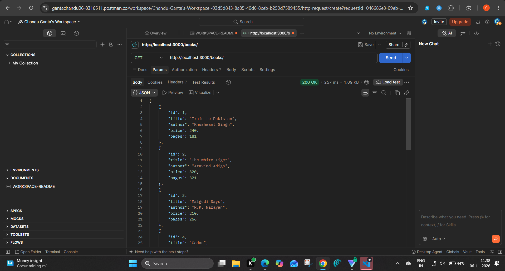
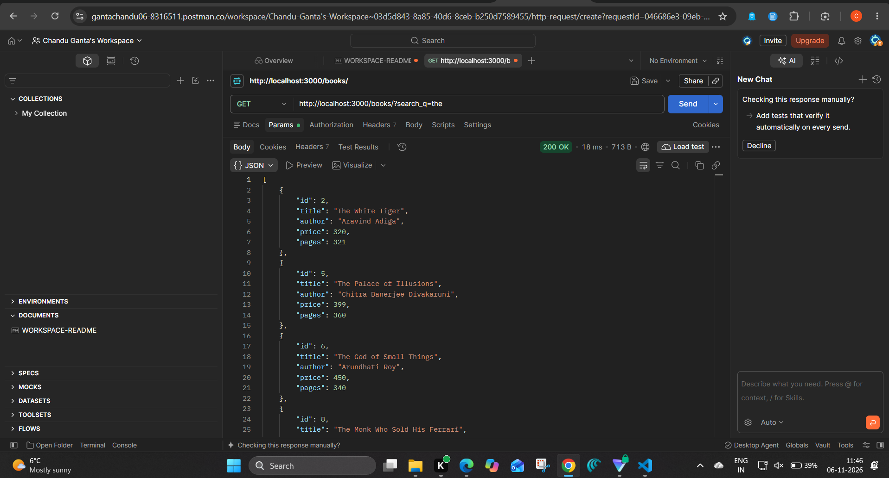
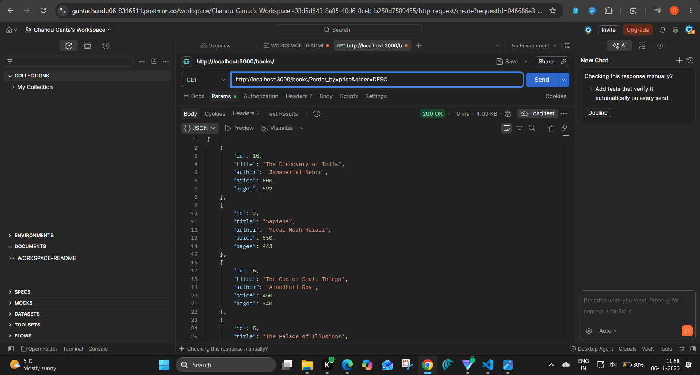
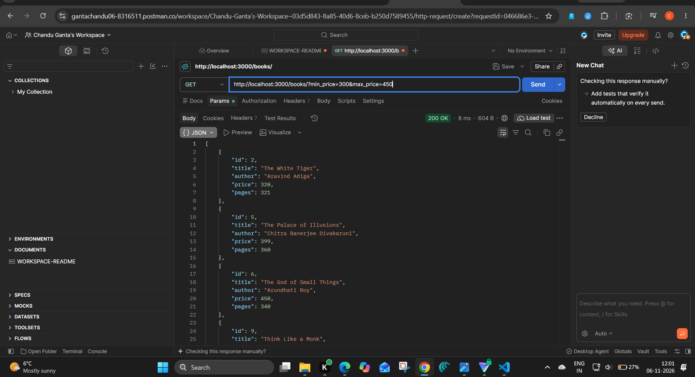
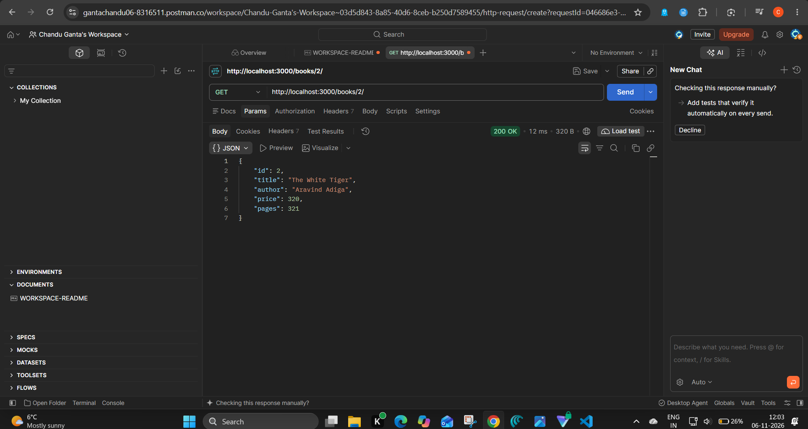
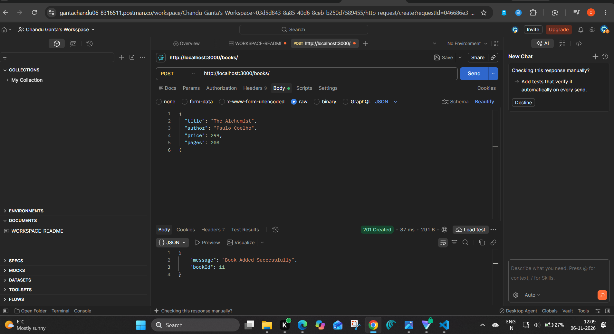
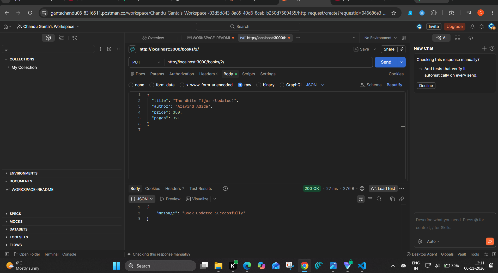

# Lab 3: REST API, query parameters, validation, debugging

- **Name:** G. Chandu
- **Registration Number:** 252U1R9037
- **Section:** GEN-AI-304-2A
- **Course:** Backend Development Fundamentals
- **Lab Number:** 03

## Live Link

**Deployment URL:** https://backend-lab-reports-3-ovfr.onrender.com

## Objective

Turn the Lab 2 routes into a clean REST API with search, sorting, pagination, a price filter, input validation, correct status codes and one consistent JSON error format.

## Technologies Used

Node.js, Express.js, SQLite (`sqlite` + `sqlite3`), nodemon, Postman, DB Browser for SQLite

## Project Structure

```
lab-03/
├── screenshots/
├── app.js                          # Express server, DB connection, routes
├── validators.js                   # body validation + query-parameter parsing and SQL building
├── books.db                        # SQLite database (table: book, 10 rows)
├── seed.sql                        # SQL to recreate the table and rows
├── Lab3.postman_collection.json    # import into Postman: all success and failure tests
├── package.json
├── .env.example
├── .gitignore
└── README.md
```

## How to Run

**Prerequisites:** Node.js and npm.

```
cd lab-03
npm install
npm run dev      # development (nodemon)
npm start        # plain: node app.js
```

Server: `http://localhost:3000/`

**Environment variables:** none are required. `PORT` is optional (default `3000`), see `.env.example`. Never commit a real `.env`.

To recreate the database: `sqlite3 books.db < seed.sql`

## Endpoints

Paths are nouns (`/books`); the HTTP method shows the action.

| Method | Path              | Description                                                   |
| ------ | ----------------- | ------------------------------------------------------------- |
| GET    | `/books/`         | List books with search, sort, pagination and price filter     |
| GET    | `/books/:bookId/` | Get one book                                                  |
| POST   | `/books/`         | Add a book (validated), returns 201                           |
| PUT    | `/books/:bookId/` | Update a book (validated), returns 200                        |
| DELETE | `/books/:bookId/` | Delete a book, returns 200                                    |

### Query parameters for `GET /books/`

| Parameter   | Default | Meaning                                                              |
| ----------- | ------- | -------------------------------------------------------------------- |
| `search_q`  | empty   | Partial, case-insensitive match on title (`LIKE`)                    |
| `order_by`  | `id`    | One of `id`, `title`, `author`, `price`, `pages`                     |
| `order`     | `ASC`   | `ASC` or `DESC`                                                      |
| `limit`     | `10`    | Whole number, 1 to 100                                               |
| `offset`    | `0`     | Whole number, 0 or more                                              |
| `min_price` | `0`     | Only books with price at or above this                               |
| `max_price` | none    | Only books with price at or below this (must not be below min_price) |

Example: `GET /books/?search_q=the&order_by=price&order=DESC&min_price=300&limit=5`

### Request body for POST and PUT

```json
{ "title": "The Alchemist", "author": "Paulo Coelho", "price": 299, "pages": 208 }
```

Rules: `title` and `author` are non-empty strings, `price` is a number of 0 or more, `pages` is a whole number of 1 or more.

### Status codes and response format

| Code | When                                                                              |
| ---- | --------------------------------------------------------------------------------- |
| 200  | Successful read, update or delete                                                 |
| 201  | Book created                                                                      |
| 400  | Bad input: invalid body, invalid query parameter, invalid id, invalid JSON        |
| 404  | The id does not exist, or the route does not exist                                |
| 500  | Unexpected server or database error                                               |

Every error has the same shape: `{ "message": "..." }`. Success responses for POST, PUT and DELETE also use `message`.

## Postman Test List

Import `Lab3.postman_collection.json` into Postman. It has 25 requests.

**Success cases**

| #  | Request                                           | Expected |
| -- | ------------------------------------------------- | -------- |
| 1  | `GET /books/`                                     | 200      |
| 2  | `GET /books/?search_q=the`                        | 200      |
| 3  | `GET /books/?order_by=price&order=DESC`           | 200      |
| 4  | `GET /books/?limit=3&offset=3`                    | 200      |
| 5  | `GET /books/?min_price=300&max_price=450`         | 200      |
| 6  | `GET /books/2/`                                   | 200      |
| 7  | `POST /books/` with a valid body                  | 201      |
| 8  | `PUT /books/2/` with a valid body                 | 200      |
| 9  | `DELETE /books/<id from step 7>/`                 | 200      |

**Failure cases**

| #  | Request                                           | Expected |
| -- | ------------------------------------------------- | -------- |
| 10 | `GET /books/?order_by=color`                      | 400      |
| 11 | `GET /books/?order=up`                            | 400      |
| 12 | `GET /books/?limit=500` and `?limit=abc`          | 400      |
| 13 | `GET /books/?min_price=500&max_price=100`         | 400      |
| 14 | `GET /books/abc/`                                 | 400      |
| 15 | `POST` with missing title, missing author, or `"price": "abc"` | 400 |
| 16 | `POST` with broken JSON                           | 400      |
| 17 | `PUT /books/2/` with an empty title               | 400      |
| 18 | `GET`, `PUT` and `DELETE` on `/books/9999/`       | 404      |
| 19 | `GET /authors/` (unknown route)                   | 404      |

## Screenshots

### GET all books


### Search by title


### Sort


### Pagination


### Price range


### GET one book


### POST (201)


### PUT (200)


### DELETE (200)


### Invalid body (400)


### Invalid query parameter (400)


### Not found (404)


### Database view


## Viva Questions

### 1. Query parameter vs path parameter?

A path parameter identifies one specific resource and is part of the URL path, for example `/books/5/`. Query parameters come after `?` and refine or filter a request, for example `/books/?search_q=the&limit=5`. They are optional and several can be combined.

### 2. What does stateless mean?

Each request carries everything the server needs to handle it. The server does not remember anything about earlier requests from the same client. That makes the API simpler to scale, because any request can be handled independently.

### 3. Which status code for bad input vs a missing record?

Bad input (invalid body, wrong query parameter) is **400 Bad Request**. A valid request for an id that does not exist is **404 Not Found**.

## Security Notes

- All user values go through `?` placeholders (parameterised queries).
- `order_by` and `order` cannot be used as placeholders, so they are checked against a fixed whitelist before being added to the SQL.
- `LIKE` wildcards typed by the user (`%`, `_`) are escaped, so they are searched as plain characters.

## Debugging Reference

The faculty gives a broken version of the project. These are the four problems and how to fix each:

| Problem | Typical error | Fix |
| --- | --- | --- |
| Port conflict | `Error: listen EADDRINUSE: address already in use :::3000` | Stop the other process using the port, or run with another port (`PORT=3001` / `set PORT=3001` on Windows). This project prints a clear message for it. |
| Wrong import path | `Error: Cannot find module './validator'` | Check the file name and the relative path, e.g. `require("./validators")`. |
| Table-name typo | `SQLITE_ERROR: no such table: books` | Use the real table name from the schema (`book`). Check it in DB Browser. |
| Missing `await` | Response shows `{}` or a pending Promise, or code runs before the query finishes | Add `await` before `db.all`, `db.get` and `db.run`, inside an `async` function. |

## Notes: Problems Faced and Solutions

- Write your own notes here: what went wrong in the faculty's broken version (or in your own testing), and how you fixed it.
